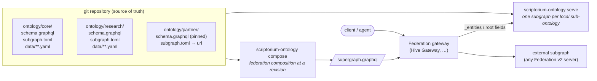

# Federated ontology (experimental)

> Status: **experiment** on `feat/no-ticket/git-federated-ontology`. Formats
> and commands may change without notice.

Scriptorium's wiki is untyped: pages, tags, and a small fixed vocabulary of
`relations`. This experiment adds a typed **ontology** layer on top of the
same principles the vault already follows — plain files, git as the
source of truth, mechanical checks before anything lands:

- **Git is the backend for the ontology itself.** Every sub-ontology's
  schema, its storage binding, and (for git-backed data) its instances
  live in a git repository. A commit is an ontology version; a branch is a
  proposed change; any revision can be composed, checked, and served.
- **Sub-ontologies are GraphQL federation subgraphs.** Each sub-ontology is
  a [Federation v2](https://www.apollographql.com/docs/graphos/schema-design/federated-schemas/federation)
  subgraph schema. Composition merges them into one supergraph and rejects
  conflicts; the `@key` directive gives entities an identity that other
  sub-ontologies can extend.
- **Storage is per sub-ontology.** Each sub-ontology declares where its
  instances live: YAML records in git, markdown files, or an external
  database. A sub-ontology can also be **remote** — any
  Federation-compliant subgraph served by someone else.
- **Runtime is a real federation.** `scriptorium-ontology serve` exposes
  every local sub-ontology as a spec-compliant subgraph over HTTP; any
  Federation v2 gateway (tested with Hive Gateway) routes queries across
  local and remote sub-ontologies using the supergraph scriptorium composes
  from git.



## Vocabulary

| Ontology term | GraphQL federation mechanism |
|---|---|
| Sub-ontology (module, owned by a team or person) | Subgraph |
| Class with identity | Object type with `@key(fields: "id")` (an *entity*) |
| Property | Scalar or enum field |
| Relation | Field whose type is another entity (stored as the target's key) |
| Inverse relation | Field marked `@inverse(of: "<field>")` — derived, never stored |
| Owning a class's instances | Plain `type X @key(...)`: this sub-ontology's records decide which X exist |
| One sub-ontology adding properties to another's class | Entity extension: `extend type X @key(...)` (or `@extends`) in the extending subgraph |
| Shared value type | Object type without `@key`, marked `@shareable` where needed |
| Moving a property between sub-ontologies | `@override(from: "<subgraph>")` |
| Ontology conflict | Composition error |
| Composed ontology | Supergraph |
| Ontology version | Git commit |

## Layout

```text
ontology/
├── ontology.toml          # optional: serve settings
├── core/
│   ├── subgraph.toml      # name, description, owners, [storage] or [remote]
│   ├── schema.graphql     # the sub-ontology (Federation v2 subgraph SDL)
│   └── data/              # git-backed instances (storage.kind = "git")
│       └── Person/
│           └── vaswani.yaml
└── research/
    ├── subgraph.toml
    ├── schema.graphql
    └── data/
        └── Paper/
            └── attention.yaml
```

A directory under `ontology/` is a sub-ontology when it contains
`subgraph.toml`. The directory name is the default sub-ontology name;
names are `[a-z][a-z0-9_]*` because they become `join__Graph` enum values in
the supergraph and path segments in subgraph URLs.

### `subgraph.toml`

```toml
description = "Papers, citations, authorship."
owners = ["@xpolb01"]

# Local sub-ontology: served by `scriptorium-ontology serve`.
[storage]
kind = "git"          # YAML records in git (default data_dir = "data"; a relative path inside the sub-ontology)

# …or a remote sub-ontology served elsewhere (exactly one of the two):
# [remote]
# url = "https://partner.example.com/graphql"
```

For a remote sub-ontology, `schema.graphql` is a pinned snapshot of the
remote subgraph's SDL. Composition always reads the pinned copy, so a
remote schema change shows up as a git diff before it reaches the gateway.

### `schema.graphql`

A plain Federation v2 subgraph schema:

```graphql
extend schema
  @link(url: "https://specs.apollo.dev/federation/v2.3", import: ["@key"])

directive @inverse(of: String!) on FIELD_DEFINITION

"A scholarly paper."
type Paper @key(fields: "id") {
  id: ID!
  title: String!
  year: Int
  authors: [Person!]!
}

"research adds authorship to core's Person; core owns Person records."
extend type Person @key(fields: "id") {
  id: ID!
  papers: [Paper!]! @inverse(of: "authors")
}

type Query {
  paper(id: ID!): Paper
  papers(first: Int): [Paper!]!
}
```

Root fields follow two conventions the server resolves automatically:

- **lookup** — returns a single, nullable entity and takes exactly one
  argument, the entity key: `paper(id: ID!): Paper` (not `Paper!`: a key
  may name nothing, which answers `null`). The argument is `ID!` or `String!`
  (`Int!` only for an Int key: an Int cannot spell a key like `alice`)
- **list** — returns a list of entities, with an optional `first: Int`
  limit: `papers(first: Int): [Paper!]!` (default 100, at most 1000)

A declared argument default (`papers(first: Int = 10)`) applies. Root
fields return entities their sub-ontology owns: an extension's records are
optional, so it can neither confirm that an entity exists nor list them.

At least one sub-ontology must declare a `Query` field; composition rejects
a supergraph without root fields.

### Git-backed records

`storage.kind = "git"` stores one YAML file per entity per sub-ontology:
`<sub>/data/<Type>/<key>.yaml`. A record holds **only the fields this
sub-ontology owns**; the key comes from the file name. Relations store
target keys:

```yaml
# ontology/research/data/Paper/attention.yaml
title: Attention Is All You Need
year: 2017
authors: [vaswani, shazeer]
```

A key repeated in a record (`authors:` twice) is an error, not an
overwrite. `Person/vaswani.yaml` in `core` holds `name`; `research` never stores
`name`, and `core` never stores `papers`. The gateway joins them by key.

**Ownership.** The sub-ontology that declares a plain `type X @key(...)`
owns X: its records decide which X exist, and an `_entities` lookup for a
key it has no record for returns `null` with an error. Sub-ontologies
that add fields to X declare `extend type X` (or `@extends`); for them any
key names an entity, and a local record is optional. When several
sub-ontologies declare a plain `type X`, each owns X and each must store
every X. `check` reports a reference to a key an owner lacks
(`ontology.record.dangling_ref`) and a record for one
(`ontology.record.orphan`): an extension's record does not make the entity
exist.

## Install

The ontology is its own Cargo workspace and binary, `scriptorium-ontology`.
It is kept apart from the main workspace because `graphql-composition`
enables serde_json's `preserve_order` feature, and Cargo unifies features
across a workspace: linked into `scriptorium`, it would change
scriptorium-core's JSON key order, and with it page content hashes.

```sh
cargo install --path crates/scriptorium-ontology
# or, for development:
cargo test --manifest-path crates/scriptorium-ontology/Cargo.toml
```

## Commands

| Command | What it does |
|---|---|
| `scriptorium-ontology init` | Scaffold the example ontology (`core`, `research`, `software`) and commit it |
| `scriptorium-ontology list` | Sub-ontologies at a revision: storage, owners, types |
| `scriptorium-ontology compose` | Compose the supergraph (`--out`, `--api` for the client-facing schema) |
| `scriptorium-ontology check` | Composition + schema + git-record validation; non-zero exit on errors |
| `scriptorium-ontology serve` | Serve local sub-ontologies as Federation v2 subgraphs over HTTP |

`compose` and `serve` refuse to run when any sub-ontology fails to load (a
malformed `subgraph.toml`, a missing schema), and `compose` also refuses
when a local sub-ontology composes but could not be served: a supergraph
that silently drops one, or routes to one that cannot start, would make its
fields vanish from the gateway. `list` warns and
`check` reports them. Before `compose --out` writes a supergraph, it asks
each local subgraph at the base URL which commit it serves (`serve` sends
it as the `scriptorium-ontology-revision` header) and what schema, and
refuses when a running server is on another commit, even one that changed
only records: restart it at the new commit first, or let
`serve --supergraph` publish. Nothing
listening yet (connection refused) is only a note; any other failure,
TLS included, refuses, since then nothing is known about what runs there.
It also asks each remote sub-ontology what it serves (no credentials are
sent) and refuses when that is no longer the pinned `schema.graphql`, or
when the remote cannot be asked. `--offline` skips both questions.
`serve --supergraph` asks the remotes the same before it writes, and once
it listens it asks its own subgraphs at the base URL the supergraph routes
to: a `serve.base_url` that reaches another (older) server, or nothing, is
refused. `serve --supergraph --offline` skips both. An answer to any of
these questions that fails (not 2xx), or is larger than 8 MiB, refuses
publishing. So does, even `--offline`, a subgraph URL a gateway cannot
connect to: not an absolute http(s) URL, or on a wildcard address
(`0.0.0.0`, `::`); bind a wildcard with `serve.base_url` set to the address
it is reached at.

All commands read from a git revision (`--rev`, default `HEAD`). Pass
`--worktree` to read uncommitted files while editing (`list`, `check`, and
`compose` to stdout; publishing with `compose --out` or `serve` reads a
commit). Reads refuse symlinked files, in the working tree
and in commits alike: a commit stores the link, not the file it names, so
the two would disagree.
A file name under the ontology that is not UTF-8 is an error, never
skipped, and so is a git link (submodule) where a record would be, or a
symlink where a sub-ontology's or a `data_dir`'s directory would be (git
reads do not follow symlinks).
Without `-C`, commands target the git repository containing the current
directory; `init` never falls back to the default vault.

### Running a federated query

```sh
scriptorium-ontology -C ~/onto init          # example: core, research, software
scriptorium-ontology -C ~/onto serve --supergraph /tmp/supergraph.graphql
npx @graphql-hive/gateway supergraph /tmp/supergraph.graphql
curl -s localhost:4000/graphql -H 'content-type: application/json' \
  -d '{"query":"{ paper(id: \"bert\") { title authors { name } cites { title implementations { url } } } }"}'
```

`paper` and `cites` resolve in `research`, `name` in `core`, and
`implementations` in `software`; the gateway plans the `_entities` calls.

Each subgraph answers `_service { sdl }` with its committed
`schema.graphql`, verbatim (`@override`, `@inaccessible`, `@tag`, and the
rest included), so a gateway that composes from the live subgraphs sees
the schema `compose` composed. Subgraphs do not answer introspection
(`__schema`, `__type`); introspect the gateway instead.

## Known limitations

- **Read-only.** Mutations are not served; change the ontology by editing
  files and committing.
- **Remote pins are checked when publishing, not while serving.** The
  supergraph routes to a remote's URL; a remote that changes its schema
  after `compose --out` or `serve --supergraph` checked it is caught only at
  the next publication. Pin a versioned URL when the schema must hold.
- **Pinned at startup.** `serve` reads one commit (it refuses
  `--worktree`); restart it after a commit, and recompose the supergraph if
  schemas changed.
- **No authentication.** `serve` binds to loopback by default; put it
  behind something that authenticates before exposing it. Requests are
  bounded (depth 32, 5000 selected fields, lists ≤ 1000, ≤ 10 000
  `_entities` representations, ≤ 100 000 resolved list items, ≤ 250 000
  field resolutions scheduled for list items and representations — items
  × the fields selected under each — and ≤ 32 MiB of answer, as encoded
  JSON: values, the response keys and `__typename`s every list item and
  entity repeats, copies of
  `_service { sdl }`, and errors for missing entities, per request,
  counted across aliases, and the whole encoded answer measured before it
  is sent; a request that exceeds any of these is answered with that one
  error), but there is no rate limiting. `check` holds a
  stored list to 1000 items, the most one list answers.
- **One publisher per supergraph.** `serve --supergraph` and `compose --out`
  take an exclusive lock (a `.<name>.lock` sibling) and replace the file
  atomically (through a symlink, its target is replaced); a second
  publisher to the same path is refused while one runs. The replacement
  keeps the old file's permissions, owner, and group (publishing fails,
  leaving the old file, when the owner or group cannot be kept). The file
  is a generated artifact: per-file ACLs and extended attributes are not
  carried over, so grant a gateway access through directory permissions or
  default ACLs rather than an ACL on the file itself.
- **Entity keys** are `ID`, `String`, or `Int` fields. For git storage the
  key is the file name, so `Int` keys must be written canonically
  (`42.yaml`, not `042.yaml`).
- **Served schema subset.** Object types, enums, custom scalars, one list
  level, one single-field `@key` per entity. Interfaces, unions, input
  objects, `@requires`/`@provides`, compound or multiple keys compose, but
  `check` reports them as errors for local sub-ontologies because `serve`
  cannot resolve them.
- **Inverse relations do not paginate.** `@inverse` lookups use a reverse
  index built per commit on first use (git storage), and more than 1000
  matches is a query error rather than a silently truncated list.
- **Missing entities.** `async-graphql`'s dynamic executor cannot return a
  `null` member of `_entities`, so the HTTP handler replaces missing owned
  entities with `null` after execution (one error each, at
  `_entities[i]`). An aliased `_entities` field still gets per-field
  errors, but not the `null` item.

## Checks

`scriptorium-ontology check` runs, in order:

1. **Registry** — every `subgraph.toml` parses, names are valid and
   unique, each sub-ontology is either local or remote, `schema.graphql`
   exists.
2. **Composition** — federation composition of every sub-ontology.
   Conflicting field types, unshareable fields defined twice, and invalid
   keys are errors, and so is a composed ontology with no Query field.
3. **Servability** — every local sub-ontology builds as a subgraph: one
   single-field ID/String/Int key per entity, lookup and list root fields
   only, and none of the directives the server cannot honour yet
   (`@requires`, `@provides`, `@context`, `@fromContext`,
   `@interfaceObject`).
4. **Records** (git storage) — every record's type is an entity of its
   sub-ontology, every field is owned by it (not `@external`, not
   `@inverse`), values match declared types, required fields are present,
   and the key in the file name is valid (a key the record also stores must
   be spelled the same and have the key's type). A relation stores the target's
   key as that key's scalar: a string or an integer, and for an `Int` key a
   32-bit integer in canonical form.
5. **Existence** — for a type that git-backed sub-ontologies own, their
   records are the entities. Errors: a reference to a key an owner lacks
   (`ontology.record.dangling_ref`), a record for one
   (`ontology.record.orphan`), and an extension that declares a required
   stored field (`rating: Int!`) with no record for some entity
   (`ontology.record.missing`). For a type owned elsewhere these can only
   be warnings: a reference no git-backed record matches, and a required
   extension field whose entities check cannot enumerate.
6. **One resolver per field** — a non-key entity field is resolved by one
   local sub-ontology (`ontology.schema.shared_field`): the gateway may
   read a `@shareable` field from any sub-ontology that resolves it, and
   separate stores cannot be kept in agreement. A field marked `@external`
   does not count, nor does one taken over with `@override(from: …)` (a
   progressive override, with `label:`, leaves both resolving). A local
   resolver beside a remote one is a warning, since `check` cannot see the
   remote's values. Local sub-ontologies key an entity by the same field
   (`ontology.schema.key_mismatch`): their records are matched by key. And a
   field taken over with `@override` must answer exactly what the old
   sub-ontology does, for every entity either of them has a record of
   (`ontology.record.override_gap`; `null`, `[]`, and absent compare the
   way the server answers them). An override whose values `check` cannot
   read (a remote or database side) is an error too, even when the old side
   stores no values (its nulls are answers too), unless both sides are
   remote. Root fields name no entity to compare by: each is resolved by
   one local sub-ontology (two is an error, one beside a remote a
   warning), and moving one with `@override` is an error unless both sides
   are remote. A derived (`@inverse`) field cannot
   be moved that way, since nothing is stored to compare, and neither can a
   relation the old sub-ontology derives an inverse from, which would keep
   reading its records.

## Why these libraries

- **Composition: [`graphql-composition`](https://crates.io/crates/graphql-composition)**
  (Grafbase, MPL-2.0). Apollo's `apollo-federation` crate is licensed
  Elastic-2.0, which is incompatible with this project's GPL-3.0; MPL-2.0 is
  GPL-compatible.
- **Subgraph runtime: [`async-graphql`](https://crates.io/crates/async-graphql)**
  dynamic schemas (MIT/Apache-2.0), which implement `_service` and
  `_entities`.
- **Gateway:** not bundled. The supergraph is the standard `join__` format;
  Hive Gateway (MIT) is the tested gateway.

## Roadmap

1. Registry, composition, checks, git-backed subgraph serving. *(this
   iteration)*
2. Markdown storage (typed notes; a read-only `Page` entity bridging the
   wiki).
3. Remote sub-ontologies: `ontology add-remote <name> <url>` and
   `ontology pull` pin a remote subgraph's SDL into git.
4. Postgres and DynamoDB storage adapters.
5. Mutations as validated git commits; branch-targeted writes as ontology
   change proposals; `ontology diff <rev> <rev>` with breaking-change
   classification.
6. MCP tools and lint integration.
